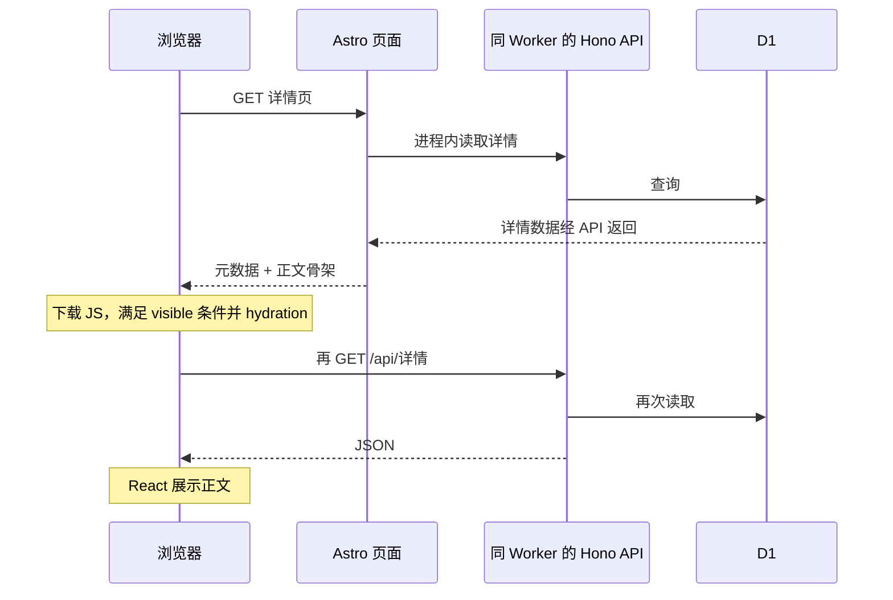

# Astro 是否适合 GoMate：框架适配性研究

调研日期：2026-10-28（Asia/Shanghai）。本地基准：`c8b41122`；核对了已安装依赖、源码、配置、官方文档，以及少量生产匿名 GET。本文是研究结论与候选建议，不是已批准的迁移 ADR，也不表示建议已经实施。

## 结论

**现有证据不足以把 Astro 判为错误选型；但 GoMate 当前的使用方式，确实没有充分兑现 Astro 的收益。** 更具体地说：

- **平台适配：合适。** 当前 Astro 的 Cloudflare adapter、workerd 开发支持和 Hono 组合入口有官方依据，不能套用“只能做静态博客”或“Cloudflare 上只能勉强跑”的旧判断。官方证据见后文。
- **产品形态：部分匹配。** 公开地点、队伍详情与分享入口需要可直接返回的 HTML；地图、筛选、表单和后台需要 React。Astro 能承载这一组合，但多页面导航与独立 island 并不自动提供应用级路由、数据重验证和跨页状态管理。
- **当前实现：存在可验证的偏差。** 31 个 Astro 页面文件中，26 个直接挂载带 hydration 指令的组件；两类关键详情页已在服务器获取实体数据，却只用于元数据，正文仍从骨架开始、等待浏览器再取数据。把这些问题全部归咎于框架会误判改造范围。
- **现有项目决策：先修正 SSR 数据流，暂不全面迁移。** 已有地点列表实现证明传递初始数据在本项目可行。若修正后，跨页面状态、loader/action 与表单重验证仍持续产生大量维护成本，再用 React Router Framework Mode 做限定范围对照。
- **假如今天从零做相同产品：倾向先评估 React Router Framework Mode。** 理由是项目已有明显的 React 应用形态，而非已证明其性能优于 Astro。TanStack Start 也是合理备选；Next.js/vinext 并没有针对当前需求显示出必须承担迁移成本的独有收益。

以上是基于证据的工程判断，不是框架性能排名。没有取得真实用户 LCP/INP、Worker CPU 分布或各方案对照实验，不能宣布 Astro 最慢、迁移更便宜，或者保证某框架更快。

## GoMate 实际需要什么

现行产品范围是“发现地点 → 创建或直接加入队伍 → 完成活动”，含双语、账号、少量后台；聊天、收藏、故事、复杂行动本已退出产品范围。因此不能拿尚未需要的协同编辑、聊天状态或离线同步证明必须采用 SPA。依据：[产品范围 ADR](adr/0001-minimal-location-team-product.md)、[页面文档](frontend-pages.md)及当前 [页面目录](../src/pages/)。

| 当前需求                   | 对框架真正提出的要求                           | 对选型的含义                                                     |
| -------------------------- | ---------------------------------------------- | ---------------------------------------------------------------- |
| 公开地点、队伍、分享链接   | 服务端正文与元数据、正确的失败响应、可链接 URL | 支持 Astro；React 全栈 SSR 也能满足，并非 Astro 独有             |
| 地图、筛选、相册、建队表单 | React 状态、请求取消、URL/history、无障碍      | 少量 island 足够；当这些成为整页主体时，Astro 的少 JS 优势会减弱 |
| 登录、我的队伍、后台       | 同源 Cookie、鉴权、数据刷新、提交后状态一致    | 应用框架的路由数据模型可能更顺手；最终权限仍必须由 API/SQL 保证  |
| D1、R2、邮件与定时任务     | Workers bindings、故障恢复、写保护、受保护发布 | 主要是后端和运维合同，换页面框架不会消除                         |
| 中英文与主题               | SSR/客户端一致、URL 与 Cookie 策略             | 当前手动路由与注入数据需要迁移或保留；不能假定替代框架自动解决   |

## 本地实现审计

### 页面形态：已经有较重的 React 应用特征

基准中共有 **31 个 `.astro` 页面文件**，其中 **26 个**含页面级 `client:*`：`client:load` 15 处、`client:visible` 11 处；这些页面文件中没有 `client:only`。有 **158 个非测试 `.tsx` 文件**（排除文件名含 `.test.` 或路径含 `__tests__`）。未发现页面级 `prerender` 声明；全局为 `output: "server"`。[页面目录](../src/pages/)、[配置](../astro.config.mjs)

计数只描述代码组织，**不是 JS 体积或用户流量占比**。一个 page-level island 内可以组合许多 React 组件；React runtime 也可由构建产物共享，不能把 island 数量当作 React 副本数量。`client:visible` 默认仍会 SSR，区别在于何时 hydration；当前详情正文为空的原因是初始数据未传入，而不是此指令禁止 SSR。

除了业务页，[privacy.astro](../src/pages/privacy.astro)、[terms.astro](../src/pages/terms.astro) 也挂载 hydrated React 页面。以隐私页为例，组件主要从 i18n 读取展示数据；这是值得评估的 hydration 范围，而非已经测得的性能瓶颈。[PrivacyClient](../src/components/features/privacy-client.tsx)

### 两类详情：承担了 SSR 读取，却没有把正文一起交付

地点详情在 `.astro` 中调用 `serverApiGet('/locations/:id')`，只使用名称、描述、封面生成元数据；传给 React 的只有 `locationId`。React 将实体设为 `null`、loading 设为 `true`，首轮返回 `LoadingSkeleton`，effect 再请求同一实体。[地点页面](../src/pages/locations/[id].astro)、[地点组件](../src/components/features/location-detail-client.tsx)

队伍详情相同：Astro 读取队伍生成标题、描述和封面，组件只接收 `teamId`；hook 初始无队伍数据，在 effect 中请求队伍及当前用户，随后请求成员状态。[队伍页面](../src/pages/teams/[id].astro)、[队伍 hook](../src/components/features/team-detail/use-team-detail.ts)、[队伍组件](../src/components/features/team-detail/team-detail-main.tsx)

这是源码所示正常路径，不是浏览器抓包统计；服务端一段是进程内 dispatch，没有绕公网 self-fetch。[server-api.ts](../src/lib/server-api.ts)

2026-10-28 的生产匿名 GET 抽样与源码一致：

| 样本                                              | HTTP | title 含实体名称 | 原始 HTML body 文本含实体名称 | 页面 island                     |
| ------------------------------------------------- | ---- | ---------------- | ----------------------------- | ------------------------------- |
| `/locations/d10c7ad4-6c00-41ee-9558-3250dbff3762` | 200  | 是               | 否                            | `LocationDetailClient`, visible |
| `/teams/ef0c8ebd-4a27-4af0-b3f3-d14545e03819`     | 200  | 是               | 否                            | `TeamDetailPartiful`, visible   |

两者返回 `X-Worker-Version-ID: a4478f2d-323c-4319-b0f6-e03e20800009`。方法：分别从公开列表 `?limit=1` 取样，再 GET 详情 HTML，以 Python HTMLParser 提取 body 中排除 script/style 的文本，与公开实体名称比对。没有保存账号、Cookie 或用户私有内容。未核对该线上 Worker 与本地 commit 的部署映射，也未测 JS 执行后的显示时间；此结果不等于“搜索引擎不能收录”或已经证实排名损失。

这一问题可以在 Astro 内修正：[地点列表](../src/pages/locations/index.astro)已经把 `initialData` 传给 React，[列表 hook](../src/components/features/locations/use-locations-list.ts)以它初始化数据，并在存在初始数据时跳过首次列表请求。这是项目内的可行机制证据，不是详情修复已经通过测试。首页也传初始数据，但 hydration 后按时间窗口和用户地区刷新队伍；不能把所有二次请求都删掉。[首页数据 hook](../src/components/features/home/use-home-data.ts)

候选修正需同时处理：只序列化可公开数据、404 与服务故障区分、首帧一致、鉴权后用户操作、加入/退出后的权威数据刷新。`serverApiGet` 目前把非成功响应或异常归一为 null，不能照搬它来宣称已经实现状态码精确处理。上述改造尚未实施。

### 架构边界：有成本，但不是一团不可拆分的框架绑定

[生产入口](../src/worker.ts)先挂 `/api` 的 Hono，再挂 `cf()`、Astro `middleware()` 和 `pages()`；scheduled 单独导出。SSR 调用同一个 `apiApp.fetch`。本地 `astro dev` 在 [middleware](../src/middleware.ts)中转发 API，生产入口则在 Astro 之前转发。这是**相同业务实现、两种入口编排**，应保留实际 Worker 集成验证，而不是声称“开发生产完全同一路径”或“两套后端”。

现有 Hono 路由、共享 contracts、D1 schema、R2 和 Better Auth 大部分可以在未来更换页面框架时保留。真正迁移成本集中在 31 个页面的路由/loader 边界、布局、手动 i18n rewrite、SSR 数据传递、导航历史、auth memo 生命周期、构建入口及端到端回归。[contracts](../src/contracts/)、[API app](../src/server/app.ts)、[客户端 API](../src/lib/api.ts)、[布局](../src/layouts/Layout.astro)

尤其 `fetchCurrentUser` 的模块级 memo 明确依赖 MPA 全页刷新重置；加入 SPA 导航或 Astro ClientRouter 时，必须重新设计退出登录、用户资料更新与缓存失效。不是给 Layout 加个 Router 就完成应用化。[客户端 API](../src/lib/api.ts)当前未发现项目使用 `ClientRouter` / `astro:transitions`；[RoutePrefetch](../src/components/layout/RoutePrefetch.astro)是文档预取，不能等同客户端路由与跨页状态保留。

### 兼容补丁不能只看注释就当作当前缺陷

仓库保留 `es-module-lexer` 根模块到纯 JS shim 的精确 alias，注释称用来避开 Workers 中的运行时 WebAssembly 编译。[配置](../astro.config.mjs)、[shim](../scripts/es-module-lexer-worker.mjs)

但本次读取已安装 `astro@7.4.0` 的 `dist/actions/actions-file.js`，其注释说明 lexer 已从 Actions 运行时图移出，只供 dev/build 使用；该文件与另一处构建插件引用的是 `es-module-lexer/minimal`，并不匹配仓库的根模块 alias。因此它是**待验证是否仍需要的历史适配**，不能用它证明当前 Astro 必须打此补丁才能运行。没有移除并重建，本报告不判定可安全删除。[上游关联 issue](https://github.com/withastro/astro/issues/17906)、[Astro 官方源码](https://github.com/withastro/astro)

## Cloudflare 层面必须分开看的问题

Workers Static Assets 与 SSR 的执行路径不同：静态资源请求免费且不限量，调用 Worker 的 SSR 请求按 Workers 规则计费。但项目全局 `output: server`、动态内容与 Cookie/i18n 策略意味着不能靠框架名称断言大量页面已静态化，也不能未处理语言与个性化就加共享缓存。[Static Assets 官方说明](https://developers.cloudflare.com/workers/static-assets/billing-and-limitations/)、[配置](../astro.config.mjs)、[middleware](../src/middleware.ts)

D1 数据位置和查询次数可能影响端到端时延。当前 DB 工厂直接 `drizzle(d1)`，全 `src` 未发现 `withSession`；官方说明不用 Sessions API 的查询仍到主库，不能因为 Worker 在边缘运行就认为数据库也在每个用户附近。本次没有读取账号侧 D1 地点/副本配置，也没有测量数据库时延；更换 Astro 不会自动改善这一点。[DB 工厂](../src/server/db/index.ts)、[D1 read replication](https://developers.cloudflare.com/d1/best-practices/read-replication/)

Workers CPU time 与等待数据库/网络的 wall time 不同。2026-10-28 查阅的 limits 页规定 Worker 未压缩 bundle 上限为 64 MiB，没有压缩体积上限；启动全局代码仍有 1 秒限制。仓库 `worker:size` 的 2.4M 目标、3M gzip hard gate 是**项目自身预算**，不能再叫 Cloudflare 平台硬上限。预算是否应改是另一个维护决策，本报告没有放宽门禁。[平台 limits](https://developers.cloudflare.com/workers/platform/limits/)、[项目大小检查](../scripts/check-worker-bundle-size.mjs)

Better Auth 已是会话来源，Astro session 被显式关闭；图片服务被配置为 passthrough/noop，不能指望换框架自动优化当前 R2 图片；Preview 写保护与生产 migration 规约也必须保留。它们分别是状态来源、媒体策略和发布安全决策。[Astro 配置](../astro.config.mjs)、[认证客户端](../src/lib/auth-client.ts)、[生产规约](prod-change-policy.md)

## 官方能力与 Cloudflare 生态

### Astro 不是只能运行静态内容的框架

Astro 官方将自身定位为内容驱动、服务端优先的框架，默认尽量少发客户端 JavaScript。这说明其优化目标，不能据此推导“有登录、表单或数据库就不适用”。React 是官方支持的组件集成；除 `client:only` 外，`client:*` 组件先在服务端生成 HTML，再按指令水合。同页多个 React island 共用框架代码，并不是每个 island 都下载一份 React。[Astro 设计目标](https://docs.astro.build/en/concepts/why-astro/)、[框架组件与水合](https://docs.astro.build/en/guides/framework-components/)

因此，首屏只有骨架究竟是框架限制，还是组件初始化没有消费服务端数据，要追踪实际数据流。`client:visible` 决定客户端何时加载交互代码，并不要求首屏内容为空；SSR 本身也不要求静态预渲染。[框架组件与水合](https://docs.astro.build/en/guides/framework-components/)

真正的结构性取舍在状态边界：独立 island 不能通过包在外面的普通 React Context 共享上下文；Astro 官方建议使用跨 island store，或自定义浏览器事件等机制。单个 React island 内部仍能使用 React Context。推论：当大量界面需要共享导航状态、草稿、乐观更新和失效刷新时，维护一个统一 React 应用树通常更直接；当交互能局部独立时，islands 更符合其设计目标。前半是框架事实，后半是工程判断。[跨 island 状态](https://docs.astro.build/en/recipes/sharing-state-islands/)

### Cloudflare 的支持是正式集成，不是边缘兼容方案

Astro Cloudflare 适配器支持按需渲染；Astro 6 起开发与本地预览使用 Cloudflare Vite plugin 和 `workerd`。因此不能套用旧判断，声称“Astro 开发必然跑 Node、生产才首次遇到 Workers”。绑定可供服务端访问；但同运行时不等于线上数据库、网络和流量特征也相同。[Astro Cloudflare 适配器](https://docs.astro.build/en/guides/integrations-guide/cloudflare/)

`astro/hono` 在 Astro 7.0 加入，是把 Astro 路由处理器组合到 Hono 的正式 API。Cloudflare 适配器还提供自定义 Worker 入口的 companion handlers。GoMate 将 Hono API 和 Astro 页面放进同一 Worker，在架构方向上有官方支持；是否正确仍需核对处理器顺序和本项目的认证、错误、重写行为，不能仅凭官方支持宣布所有组合都正确。[Astro Hono API](https://docs.astro.build/en/reference/modules/astro-hono/)、[Cloudflare 高级路由集成](https://docs.astro.build/en/guides/integrations-guide/cloudflare/#using-advanced-routing)

需要明确管理的集成选项包括：Astro Sessions 在 Cloudflare 上默认配置 KV；图片支持 Cloudflare Images binding、构建时转换或 passthrough 等模式。这些是可选择的能力，不代表使用 Astro 就必须增加另一套登录会话或付费图片处理。[Cloudflare Astro 指南](https://developers.cloudflare.com/workers/framework-guides/web-apps/astro/)、[适配器选项](https://docs.astro.build/en/guides/integrations-guide/cloudflare/#options)

`i18n.routing: "manual"` 是官方支持的扩展点，会关闭内置 i18n middleware，由应用实现路由规则。手工路由可以带来维护负担，但它的存在本身不是框架缺陷或使用未支持 API 的证据。[Astro i18n 手工路由](https://docs.astro.build/en/guides/internationalization/#manual)

### 平台和业务复杂度不会随更换前端框架消失

D1 单个数据库实例的吞吐受查询时长及每请求开销影响；数据库读副本、会话一致性、查询数量和索引是独立于 UI 框架的变量。换成 React Router、TanStack Start 或 Next.js，仍需设计相同的成员容量约束、认证和数据库访问路径。[D1 限制](https://developers.cloudflare.com/d1/platform/limits/)、[D1 读副本](https://developers.cloudflare.com/d1/best-practices/read-replication/)

Workers 还需分别观察 CPU、实际响应时间、启动时间和 bundle 大小。等待数据库或网络的时间不能直接等同 CPU 消耗。截至本次查阅，官方 Worker 大小限制为未压缩 64 MiB，且不再限制压缩大小；项目自设的 gzip 门禁应单独标注，不能当作平台当前硬限制。性能比较必须用同一业务、数据和运行条件，而不是从框架名称推断。[Workers 平台限制](https://developers.cloudflare.com/workers/platform/limits/)

## 可替代方案：能解决什么，不能解决什么

以下是能力与适配判断，不是 GoMate 迁移后的实测排序。候选之间应沿用相同 Hono 业务 API、DTO、D1/R2 与权限约束，避免把后端重写收益归到前端框架上。

| 方案                        | 官方能力与 Cloudflare 路径                                                                                    | 对 GoMate 的可能收益                                                        | 代价或限制                                                                                                                 |
| --------------------------- | ------------------------------------------------------------------------------------------------------------- | --------------------------------------------------------------------------- | -------------------------------------------------------------------------------------------------------------------------- |
| 保留 Astro + React          | 按需 SSR、局部水合、官方 Workers 适配器和 Hono 路由组合                                                       | 公共发现/详情页输出 HTML，交互局部接管；可保留现有组件和后端                | 需要清晰定义 SSR 数据到 island 的传递；跨 island 状态和整页应用体验需额外设计                                              |
| React Router Framework Mode | 官方 Cloudflare 指南已使用 v8 + Vite plugin；`loader` 负责首访与客户端导航数据，actions 提供写后 revalidation | 为表单、成员操作、管理页和导航建立一致的数据生命周期；已有 React 组件可复用 | 要迁移路由、Layout、数据加载与认证入口；官方当前 CF 插件路径不支持该框架的 SPA mode 和 prerendering，SPA 应另用 React 模板 |
| TanStack Start              | 官方当前标为 stable；SSR、streaming、server functions、类型化路由；CF 有 Vite 集成                            | 搜索参数、类型化路由及复杂客户端应用体验有吸引力                            | 要引入新的路由与服务端函数边界；CF 当前不支持其 Rsbuild 路径；RSC 仍是实验能力                                             |
| Next.js API + vinext        | Cloudflare 当前默认推荐 vinext，它用 Vite 重实现 Next.js API；官方仍标为 beta                                 | 若有明确 RSC、Next.js 生态依赖，可获得对应模型                              | Beta 和 API 兼容面要逐项验收；GoMate 当前不是既有 Next.js 项目，不能把“接入既有 Next.js”流程的便利等同于 Astro 迁移成本    |
| Next.js + OpenNext          | 将 Next.js 构建产物适配至 Workers；CF 仍保留部署路径                                                          | 已有 Next.js/OpenNext 资产或特定兼容需求时有价值                            | 对当前 GoMate 会引入另一套页面框架与构建适配；没有证据证明它能更省心地解决现有业务问题                                     |
| React + Vite + Hono SPA     | CF 官方 React 模板支持 SPA 静态资源与 Worker API                                                              | 登录后工作流可统一在 React 树中；保留 Hono API 相对自然                     | 纯 SPA 不自动提供每个公开详情的服务端正文和分享元数据；补齐 SSR 后需重新评估复杂度                                         |

表格来源：[Astro 集成](https://docs.astro.build/en/guides/integrations-guide/cloudflare/)、[Cloudflare React Router](https://developers.cloudflare.com/workers/framework-guides/web-apps/react-router/)、[React Router loaders](https://reactrouter.com/start/framework/data-loading)、[React Router actions](https://reactrouter.com/start/framework/actions)、[TanStack Start overview](https://tanstack.com/start/latest/docs/framework/react/overview)、[Cloudflare TanStack Start](https://developers.cloudflare.com/workers/framework-guides/web-apps/tanstack-start/)、[Cloudflare Next.js/vinext](https://developers.cloudflare.com/workers/framework-guides/web-apps/nextjs/)、[OpenNext 架构](https://opennext.js.org/cloudflare)、[Cloudflare React + Vite](https://developers.cloudflare.com/workers/framework-guides/web-apps/react/)。

React Router 的优势应准确描述为“有统一数据生命周期的应用框架”，而非“天然绕过权限问题”。其官方明确提示，父路由 loader 的登录检查不能独自保护并行执行或单独请求的子 loader/actions；仍需合适的服务端 middleware 和各资源权限校验。GoMate 现有最终写语句约束、写保护和 Preview 边界不能因迁移被弱化。[React Router 数据加载与权限](https://reactrouter.com/start/framework/data-loading#authentication-and-authorization)

## 版本与证据边界

- 在线官方文档会滚动更新。本次只用正式文档、维护方文档及项目源码建立论据，未将搜索返回的预览域名、旧版本教程或社区经验当作当前事实。
- 本次查阅 React Router latest 显示 8.5.1，7.x 分支为 7.18.5；Cloudflare 指南也已采用 v8。因此不应继续把“React Router v7”写成当前最新方案。候选若采用 v7，需要明确固定版本和维护原因。[React Router 当前文档](https://reactrouter.com/start/framework/data-loading)
- TanStack Start 已在当前官方文档标为 stable；vinext 在 Cloudflare 当前指南仍标为 beta。二者不能依照较早的印象统一归为“不成熟”，也不能仅凭 stable/default recommendation 宣称已验证适合 GoMate。
- OpenNext 官方页面部分说明仍包含已过时的版本日期或旧 Worker 体积限制；平台限额以 Cloudflare 当前拥有该事实的文档为准。本文只采用其构建适配机制，不沿用那些过期数字。
- 未搭建候选项目，未进行跨框架基准、全业务迁移或成本测算。任何“更快、更便宜、减少多少维护时间”的数值结论都不在本轮证据范围内。

## 建议与可推翻条件

当前建议是继续保留 Astro，先兑现已有 SSR 读取的价值，再判断是否值得迁移。它不等于永久维持现状，也不以历史投入作为唯一理由；主要依据是已经确认的问题有局部修正路径，而替代框架的净收益尚无对照证据。

| 优先级 | 后续候选工作（本次未实施）                                      | 验收证据                                                                                       | 是否需要换框架 |
| ------ | --------------------------------------------------------------- | ---------------------------------------------------------------------------------------------- | -------------- |
| 高     | 地点与队伍详情复用服务端初始数据，定义失败状态与安全序列化边界  | 原始 HTML 含公开正文；hydration 一致；消除仅为首屏正文的重复详情读取；身份相关操作保持权威刷新 | 否             |
| 中     | 复核隐私/条款等展示页的 hydration、全局 i18n 注入与详情首屏依赖 | 对同一页面比较传输 JS、主线程任务和可用时间；不预设收益大小                                    | 否             |
| 中     | 核对历史 lexer 适配是否仍需要                                   | 移除候选前后构建、隔离 Workers 和关键 SSR 回归；明确实际依赖图                                 | 否             |
| 条件性 | 以 React Router 做代表性流程实验                                | 真实 Workers 运行时、同一 Hono API/数据/权限；完整导航与写后刷新、双语、登录、回退和失败恢复   | 是，但先实验   |

不要把所有 JSX 重写为 Astro，也不要为了“岛屿更小”机械拆分有紧密共享状态的表单。能传入初始数据并完成 SSR 的整块 React 页面，本身可以是合理中间状态。公开数据与用户身份/成员状态分开处理，避免把私有内容错误地序列化到公开响应或共享缓存。

若要做迁移对照，应同时保留三组：当前实现、修正数据流后的 Astro、候选 React Router。选一条公开浏览链路（地点列表→详情→队伍详情）和一条提交链路（创建队伍或后台编辑）；候选复用现有 API，不借机重写数据库。否则把“未优化 Astro”与“已经重做数据流的新框架”相比，无法识别收益来自哪里。

记录相同设备/网络/地区、冷暖缓存、数据规模及访问状态下的 HTML 正文、请求数与重复读取、JS 压缩字节、LCP/INP、导航/提交反馈时间、Worker CPU/启动时间与 D1 查询耗时；并记录实现同一个流程实际改动的边界和维护工作。实验室测量与真实用户指标分别标注。业务写入和浏览器回归只使用隔离本地 D1，不能把连接正式 D1/R2 的 Preview 用作写入实验。[性能规范](../CODING_STANDARDS.md)、[生产边界](prod-change-policy.md)

只有当统一路由与数据生命周期持续减少了实际维护成本，候选通过现有认证/双语/Worker/浏览器门禁，且关键用户指标没有不可接受的退化时，才有理由批准迁移。可推翻当前“保留”建议的证据包括：产品新增必须跨页保持的复杂状态、Astro 内局部修正仍无法满足已明确的交互指标，或候选实验显示明显而可重复的维护收益。反过来，如果局部修正足以满足需求，保留 Astro 就是合理终点。阈值和产品取舍应在实验前确定，本文不虚构数值目标或工期。

## 本轮验证与限制

- 已核对本地 `package.json` 与已安装包：Astro 7.4.0、Cloudflare adapter 14.4.0、React integration 7.1.0、React 19.3.1。它们是项目现状，不表示全部为公开最新版本。
- 已检查页面/组件计数、两类详情到 API 的调用链、列表初始数据、生产与开发入口、认证 memo、i18n、数据库工厂及相关构建配置。
- 已查阅文内官方来源，并对生产公开详情做少量匿名 GET；无账号登录、业务写入、资源变更或部署。另一次不存在 ID 的探测收到 HTTP 403，未能验证业务 404 路径，不能据此宣称存在 soft-404 或鉴权缺陷。
- 本轮只新增研究文档，没有修改运行时代码或删除历史补丁。未重跑构建、全套测试或浏览器性能测试；已有 `dist` 和历史文档的 bundle/测试数字没有作为当前实测。
- 未获得线上流量、SEO 转化、真实用户性能或账单证据；本文不能证明迁移 ROI，也不建议仅凭框架宣传启动全量重写。
