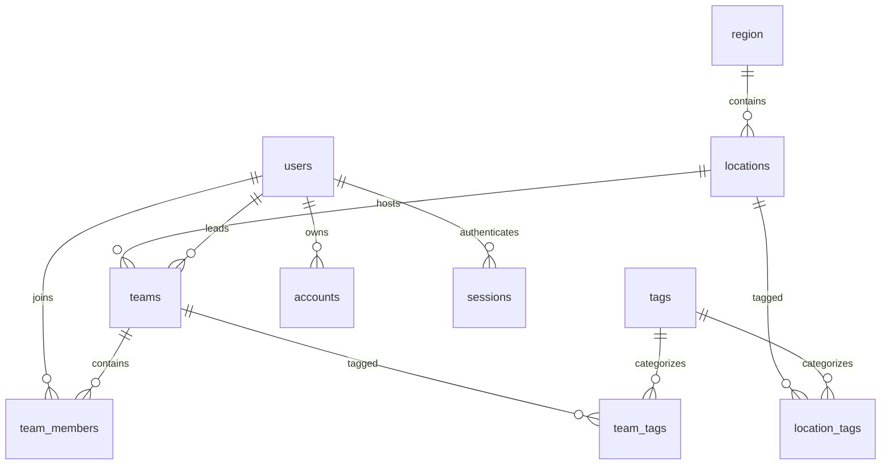

# GoMate 数据与存储

可执行事实来源为 [Drizzle schema](../src/server/db/schema.ts)、[有序 migrations](../migrations/) 与数据库/HTTP 测试。本文描述当前分支模型，不代表远程 D1 已应用全部迁移。

## 核心模型

完整本地迁移后的应用模型为 11 张表（不计 Wrangler migration 元数据）：

| 领域 | 表                                               | 职责                               |
| ---- | ------------------------------------------------ | ---------------------------------- |
| 账号 | `users`、`accounts`、`sessions`、`verifications` | 用户状态、登录凭据、会话、验证挑战 |
| 目录 | `region`、`locations`、`tags`、`location_tags`   | 地区、地点与兴趣分类               |
| 组队 | `teams`、`team_members`、`team_tags`             | 队伍、成员状态和分类               |

关系图省略了可空字段、索引和所有 CHECK；具体约束由 schema 与 migration 共同定义。公开 DTO 不直接暴露整行数据库记录。

## 地点与队伍约束

- Region 层级与服务开关决定地点公开资格；稳定参考目录由 migration 管理。测试账号与可变 demo 数据只存在本地 fixture，不进入 migration。
- Location 路由使用全局 ID；地点支持的活动类型是共享代码枚举，标签属于目录实体。
- 队长属于人数总数，但不重复写成 active member。`team_members` 以队伍/用户唯一，`left_at` 表示退出，重新加入复用同一行。
- 加入以条件 SQL 在最终写入复核 active 用户、开放招募、未取消、开始时间与剩余名额；触发器阻止超员、队长重复计入及把上限缩到当前人数以下。
- `recruitment_status` 描述开放/关闭招募；生命周期由 `formed_at`、`cancelled_at`、开始/结束时间派生。已成行活动在结束时间后为 completed，不维护另一套漂移的完成状态字段。
- 集合信息存于 `teams.meeting_point`；JSON 要求字段使用 Drizzle JSON mode，业务传数组/对象，不维护字符串兼容层。
- Cron 每小时关闭结束超过 24 小时、未成行且仍开放的队伍；最终 UPDATE 复核条件，`WRITE_MODE` 非 open 则跳过。

D1 多语句原子操作使用 `batch()` 与条件 DML；不要使用客户端 `db.transaction()` 或裸 `BEGIN`/`COMMIT`。[D1 的 batch 事务语义](https://developers.cloudflare.com/d1/worker-api/d1-database/#batch) 保证序列中失败时回滚整个批次；单次业务外的 R2/邮件不属于此事务。

## 认证、删除和媒体

认证挑战、会话创建与使用必须复核用户 active 且未删除。账号删除保留匿名墓碑及核心历史外键，并清除凭据、会话、挑战和自有头像。管理员的角色来自当前用户记录。

地点默认归档。物理删除需要显式确认且无队伍引用，Location/Team 历史关系受 RESTRICT 保护。成员与标签连接按业务父记录删除；迁移重建父表时不能误触级联而丢失需要保留的子表。

R2 保存头像与地点媒体，D1 保存所有权和引用。跨 R2/D1 操作采用临时/最终对象、条件 DML 和补偿清理，不声称具有跨存储原子性。历史故事/海报对象不再由应用引用，但此次 schema 清理不执行全 bucket 或模糊前缀删除；对象处置需另行清单与恢复方案。

### 待执行的退役 R2 对象处置

此次代码/DDL 删除不执行任何远程 R2 删除。2026-10-17 控制台盘点发现 `stories/` 下有一个 179 B 的历史对象（2026-07-18），`temp/stories/` 为空。当前 v3 的故事表为空，无法由其证明该历史对象归属及恢复副本，因此保留该对象。共享桶还存在旧 `share/`、`incremental-cache/` 和 `location/`，这些不因目录名称而被认定为可删除。旧代码可确认故事临时对象前缀为 `temp/stories/{userId}/`，正式故事对象为 `stories/{storyId}/`；它们只是盘点候选，不能仅按字符串前缀直接删除。

后续处置需要在受保护流程中先生成只读 inventory：列出精确 key、大小、ETag/版本、创建时间与可恢复副本，记录旧故事记录能够证明的归属；再从保留的用户头像、地点封面/图片及其扩展资料中提取当前引用，与候选集合相减。外部 URL、归属不明对象、仍被核心数据引用的对象均排除并人工核对。批准后的精确清单分批执行，失败可重入并记录结果，不递归删除共享 bucket。

`avatars/`、`locations/`、`temp/avatars/`、`temp/locations/` 和 `temp/location-delete-backups/` 属于保留媒体及补偿流程，不能纳入故事清理。旧海报的 `share/location`、`share/team`、`share/story` 是缓存身份，不足以证明存在可删 R2 对象；字体也需独立盘点引用，不能把删除海报代码等同于授权删字体。数据恢复与 Worker 回滚分开记录。

## 迁移与发布阶段

已应用的历史 migration 不改写。`0001` 是稳定参考数据，`0003` 是已退役 v2 的公开目录导入；历史脚本里存在旧功能名称不代表这些功能仍开放。

本轮分两阶段：

1. `0010_minimal_team_meeting_point.sql` 添加集合信息字段并提取旧行动本中的集合信息。旧列/旧表仍在，允许先部署不再读取它们的新 Worker。
2. `0011_minimal_product_contract.sql` 删除 8 张退役表和旧 `checklist` 列。重建 Team 时先保留成员与标签数据再恢复，重建核心触发器并验证外键；完整本地数据库走到此状态。

生产使用 [发布阶段清单](../migrations/production-phases.json) 和 [迁移规划器](../scripts/production-migrations.mjs) 校验 SQL 摘要、顺序和连续前缀。`0011` 已在发布清单中启用：兼容 Worker、观察时间段、验证链接及旧版本回滚窗口关闭记录均随清单审核。生产只推进获准的连续前缀；实际执行状态仍需读取 D1 migration 记录确认，无环境变量绕过。具体授权见 [生产变更规约](prod-change-policy.md)。

[Cloudflare migrations](https://developers.cloudflare.com/d1/reference/migrations/) 按 migration 记录执行；Worker 版本回滚不会恢复删除的 D1 数据。删表后的恢复需匹配的数据恢复方案与兼容 Worker，不能仅回退旧代码。

## 验证与尚未采用的能力

`pnpm db:check` 检查 schema、journal、snapshot 与迁移链同步；本地迁移测试覆盖空库重放、带旧数据升级、核心记录保留、外键完整性和人数竞争。迁移验证不能由 TypeScript 通过替代。

当前没有 KV、Queues、outbox、异步聚合或读副本 session 调度。未来非敏感路由副本、汇总表、队列与预计算按 [可靠性与性能设计](../CODING_STANDARDS.md#可靠性与性能设计) 记录统计口径、允许延迟、恢复方式和实测收益；权限与人数约束不得改用最终一致缓存。
